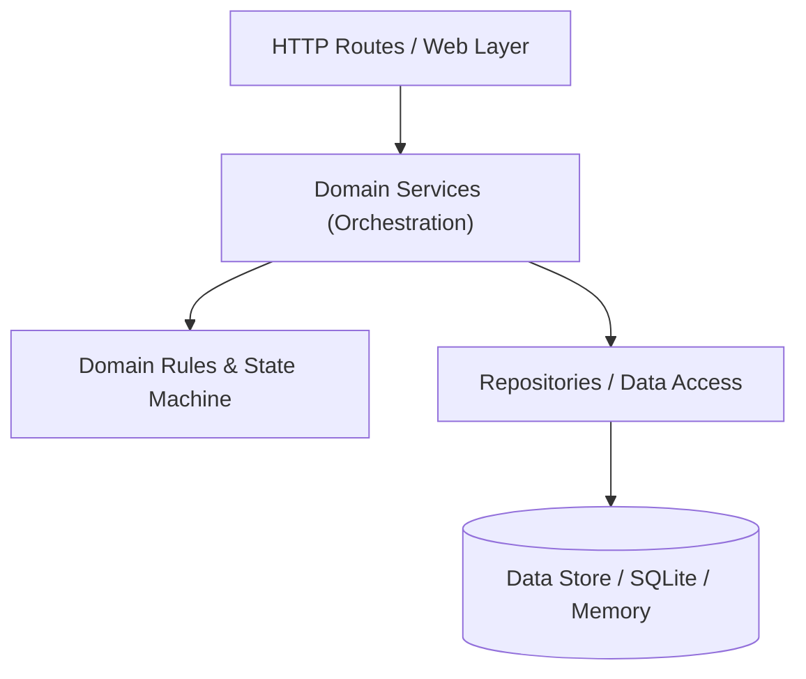
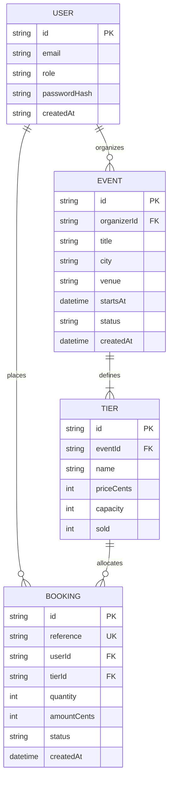
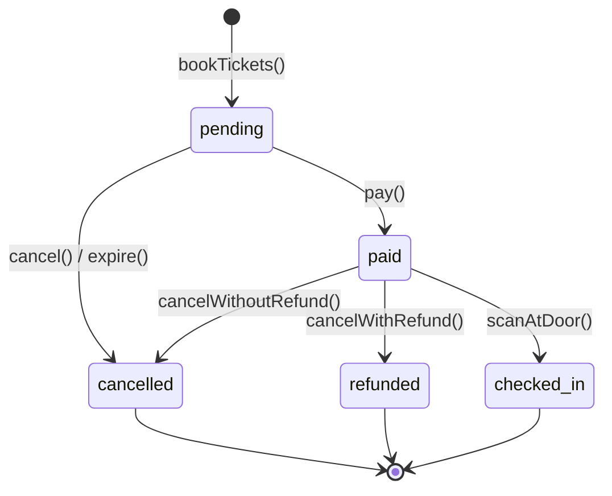

# System Architecture & State Machine

## 1. System Layers

The application is structured into four strict unidirectional layers. Calls only flow downward; lower layers never import or call upper layers.

### Layer Responsibilities & Boundaries

- **HTTP Routes / Web Layer (`src/http/`):**
  May parse HTTP requests, extract parameters and headers, validate request serialization, invoke services, and format HTTP responses (status codes and JSON); it may **not** execute business logic, mutate domain entities directly, or access repositories directly.
- **Domain Services Layer (`src/services/`):**
  May orchestrate multiple domain operations, coordinate transactions, interact with repositories, and enforce service-level workflows; it may **not** handle HTTP primitives (such as request/response objects) or bypass domain rules.
- **Domain Rules & State Machine (`src/domain/`):**
  May enforce pure business logic, invariants, state transitions, validation, and computations using pure functions and domain error types; it may **not** perform I/O, database access, network calls, or HTTP interactions.
- **Repositories & Data Access (`src/repos/`):**
  May execute queries, map rows or storage records to domain entities, and handle persistence mechanics; it may **not** decide business policies, execute state transitions, or depend on HTTP layers.

---

## 2. Data Model

The relationships between key domain entities:

---

## 3. Booking Life Cycle State Machine

All bookings follow an explicit finite state machine. Terminal states (`cancelled`, `refunded`, `checked_in`) cannot transition to any other state.

### State Machine Rules Matrix

| Current State | Target State | Allowed? | Trigger / Context |
|---|---|---|---|
| `pending` | `paid` | **Yes** | Attendee completes payment |
| `pending` | `cancelled` | **Yes** | Attendee cancels hold or hold expires |
| `paid` | `checked_in` | **Yes** | Door staff scans valid QR code |
| `paid` | `refunded` | **Yes** | Cancellation eligible for refund |
| `paid` | `cancelled` | **Yes** | Cancellation past refund window (0% refund) |
| `cancelled` | *Any* | **No** | Terminal state |
| `refunded` | *Any* | **No** | Terminal state |
| `checked_in`| *Any* | **No** | Terminal state |
